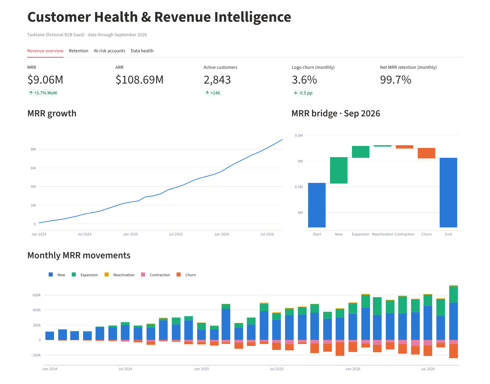
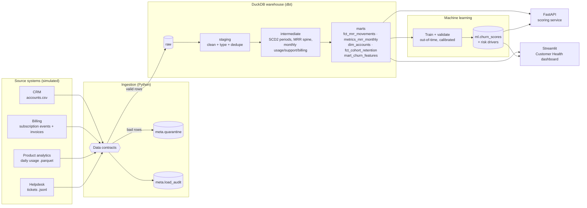
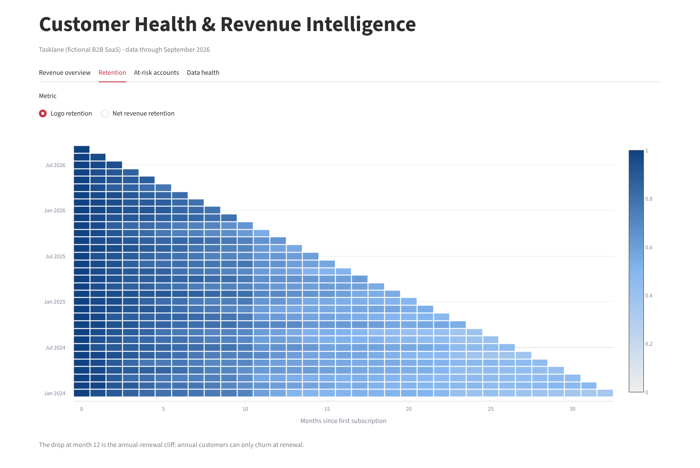
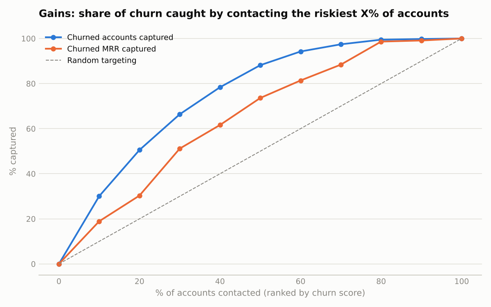
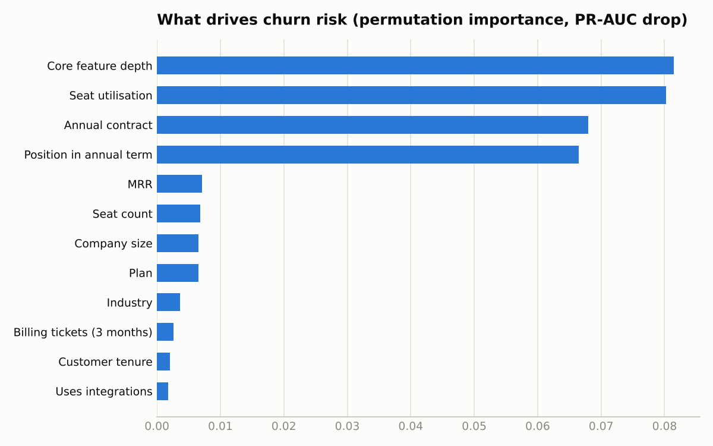
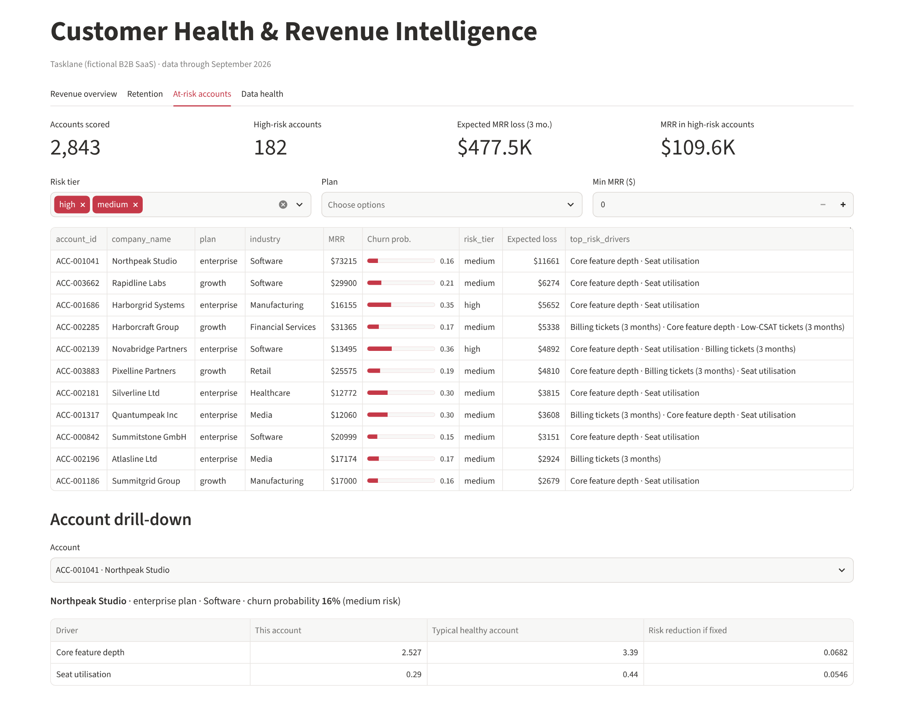

# SaaS Revenue & Churn Intelligence Platform

[](https://github.com/samikshapaturde01/saas-revenue-intelligence/actions/workflows/ci.yml)


An end-to-end data platform for a B2B SaaS company: raw source-system exports go in, and out come a tested revenue warehouse, a churn-prediction model, a scoring API and a dashboard the Customer Success team can work from.

**The business question:** *Which customers are about to churn, how much revenue is at risk, and what should we do about each one?*



---

## What's inside

| Layer | What it does | Tech |
|---|---|---|
| **Source systems** | Simulates 33 months of a SaaS business: CRM, billing, product analytics and helpdesk exports, including the messy parts | Python, NumPy |
| **Ingestion** | Contract-validated, incremental and idempotent loads; bad rows are quarantined and every load is audited | DuckDB, YAML contracts |
| **Warehouse** | Staging → intermediate → marts: MRR movements, KPI waterfall, cohort retention, a point-in-time ML feature mart | dbt (63 data tests) |
| **Data science** | Churn model with out-of-time validation, calibration and per-account risk drivers | scikit-learn |
| **Serving** | REST API for the CRM, plus a Customer Health dashboard for CSMs | FastAPI, Streamlit |
| **Engineering** | One-command pipeline, Docker, unit + end-to-end tests, CI on every push | Docker, GitHub Actions, pytest |

## Architecture



---

## Quick start

```bash
git clone https://github.com/samikshapaturde01/saas-revenue-intelligence.git
cd saas-revenue-intelligence
python -m venv .venv && source .venv/bin/activate
make install

make pipeline     # simulate -> ingest -> dbt build -> train -> score  (about 30 s)
make dashboard    # http://localhost:8501
make api          # http://localhost:8000/docs
```

Or run everything in containers:

```bash
docker compose up --build    # pipeline runs once, then API (:8000) and dashboard (:8501) start
```

Every step can also be run on its own: `revintel generate | ingest | transform | train | score`.

---

## 1. Data engineering: getting raw data in safely

The simulator writes the kind of exports a real company would have, **including real-world data problems** that the pipeline has to handle:

| Source | Volume | Deliberate data-quality issues |
|---|---|---|
| CRM accounts | 4.3K rows | stale duplicate versions, `us` / `" US "` country codes, missing industry |
| Subscription events | 11K rows | change log that has to be rebuilt into point-in-time state |
| Invoices | 30K rows | three currencies, negative amounts from an upstream bug |
| Daily product usage | 1.2M rows | days re-sent by the upstream job (duplicates) |
| Support tickets | 16K rows | mixed UTC offsets, `HIGH` / `High` / `high`, orphan tickets with no account |

**How ingestion works** ([`src/revintel/ingest`](src/revintel/ingest)):

- **Data contracts** ([`config/contracts.yaml`](config/contracts.yaml)) declare the type, required flag, allowed values, regex and range for each column.
- **Row-level quarantine:** bad rows go to `meta.quarantine` with a machine-readable reason (`amount_cents:below_min`), so nothing is silently dropped.
- **Circuit breaker:** if more than 5% of a file fails, the whole file is rejected. A broken upstream feed shouldn't half-load.
- **Idempotent and incremental:** files are fingerprinted with SHA-256, so re-running only loads new extracts (CI checks this on every push).
- **Observability:** every attempt is logged in `meta.load_audit` and shown on the dashboard's *Data health* tab.
- **ELT:** raw tables keep values exactly as delivered; all typing and cleaning happens in dbt where it's versioned and tested.

## 2. Analytics engineering: a revenue warehouse you can trust

The dbt project ([`dbt/`](dbt)) follows the staging → intermediate → marts convention.

**Key modelling decisions**

- **Subscription state as SCD type 2.** The billing change log becomes validity windows (`int_subscription_periods`), so MRR can be computed *as of any point in time*.
- **A densified account-month spine** (`int_account_mrr_monthly`) with 0 MRR while churned. This makes `lag()`-based movement logic correct for reactivations, which most naive MRR models get wrong.
- **MRR movements** classify every account-month as new, expansion, contraction, churn, reactivation or retained. Every SaaS metric is then built from that one table.
- **Annual plans** are normalised to monthly MRR. FX is converted with a monthly rate seed.

**Marts**

| Model | Grain | Used for |
|---|---|---|
| `fct_mrr_movements` | account × month | MRR bridge, expansion and contraction analysis |
| `metrics_mrr_monthly` | month | MRR/ARR, logo churn, gross/net MRR retention, ARPA |
| `dim_accounts` | account | status, current plan, lifetime revenue, churn reason |
| `fct_cohort_retention` | cohort × months since start | logo retention and NRR heatmaps |
| `mart_churn_features` | account × snapshot month | point-in-time ML features + forward-looking label |

**63 data tests.** Beyond the usual `unique` / `not_null` / `relationships` / `accepted_values`, four singular tests check the business logic and catch the bugs that actually matter:

- `assert_mrr_waterfall_reconciles`: starting MRR + all movements = ending MRR, every month
- `assert_mrr_continuity`: this month's starting MRR = last month's ending MRR
- `assert_active_customers_match_dim`: the KPI table and the account dimension agree
- `assert_features_no_future_snapshots`: no labelled feature row whose label window isn't fully observed (a leakage guard)

`make docs` opens the dbt docs site with the full lineage graph. **Exposures** link the marts to the dashboard and API that consume them.



*The step down at month 12 is the annual-renewal cliff: annual customers can only churn at renewal. It shows up in the data the same way it does in real SaaS businesses.*

## 3. Data science: predicting churn 3 months ahead

**Problem framing:** for every active account at each month-end, predict whether its MRR will drop to zero within the next 3 months. The goal is to give the CS team enough lead time to act.

**Features** (all computed point-in-time in SQL): product engagement (seat utilisation, core-feature depth, usage trend vs. the prior 3 months), commercial signals (plan, seats, MRR change, position in the annual term), support experience (tickets, low-CSAT tickets, average CSAT) and billing health (failed payments).

**Validation design.** This is where churn models usually go wrong:

- **Out-of-time split:** train on 2024-02 → 2025-09 snapshots, validate on 2026-01 → 2026-06.
- **Purge gap equal to the label horizon,** so no training label "sees" into the validation period.
- **Model selection on PR-AUC,** not accuracy (the base rate is 10.7%).
- **Isotonic calibration,** so a score of 0.30 really means ~30%. That matters because the scores are multiplied by MRR to get expected revenue loss.

**Results on the out-of-time validation set (12,277 account-months):**

| Model | ROC-AUC | PR-AUC | Precision @ top 10% | Lift @ top 10% |
|---|---|---|---|---|
| Logistic regression (baseline) | **0.789** | **0.284** | 32.6% | **3.0×** |
| Gradient boosting | 0.783 | 0.283 | 31.7% | 3.0× |
| Random | 0.500 | 0.107 | 10.7% | 1.0× |

The regularised logistic regression matched the gradient-boosted model, so I shipped the simpler, more explainable one. Contacting the riskiest 20% of accounts catches **50% of upcoming churners**; the riskiest 40% catches 78%.

| Gains | Drivers |
|---|---|
|  |  |

**Per-account explanations.** For each account, the scorer asks: *if this feature looked like a typical healthy customer's, how much would the risk drop?* The top three answers become that account's risk drivers (for example, "seat utilisation 12% vs 44% typical"). Firmographics are excluded because a CSM can't change them.

**An honest limitation.** The model captures churned *accounts* better than churned *MRR*: the riskiest 20% hold only 30% of churned revenue. Large accounts churn less often but cost more when they do. My next iteration would add a revenue-weighted objective or a separate enterprise model (see *Next steps*).

## 4. Forward-deployed: putting the model in front of users

**Scoring API** ([`src/revintel/api/app.py`](src/revintel/api/app.py)): built so a CRM or internal tool can consume it.

| Endpoint | Purpose |
|---|---|
| `GET /v1/accounts/at-risk?tier=high&min_mrr=1000` | The CS call list, ranked by **expected MRR loss** (probability × MRR) |
| `GET /v1/accounts/{id}/churn-risk` | One account's score, tier and top risk drivers |
| `POST /v1/score` | Real-time scoring from a feature payload (validated with Pydantic) |
| `GET /v1/metrics/summary` | Headline KPIs for embedding elsewhere |
| `GET /health` | Model and warehouse status for monitoring |

```bash
$ curl "localhost:8000/v1/accounts/at-risk?tier=high&limit=1"
[{
  "account_id": "ACC-001686", "company_name": "Harborgrid Systems",
  "churn_probability": 0.35, "risk_tier": "high",
  "mrr_usd": 16155.0, "expected_mrr_loss_usd": 5652.29, "plan": "enterprise",
  "top_drivers": [
    {"label": "Core feature depth", "value": 1.54, "typical_healthy_value": 3.39, "impact": 0.18},
    {"label": "Seat utilisation",   "value": 0.12, "typical_healthy_value": 0.44, "impact": 0.12}
  ]
}]
```

**Customer Health dashboard** ([`dashboard/app.py`](dashboard/app.py)) has four tabs: revenue overview (KPIs, MRR bridge, movements), cohort retention, at-risk accounts (filterable call list with drill-down into drivers), and data health (load audit and quarantine).



---

## Project structure

```
├── config/
│   ├── settings.yaml          # all knobs; override any with REVINTEL_<SECTION>__<KEY>
│   └── contracts.yaml         # data contracts per source
├── src/revintel/
│   ├── simulate/generator.py  # SaaS business simulator (source systems)
│   ├── ingest/                # contract validation + incremental loader
│   ├── ml/                    # features, training/evaluation, batch scoring
│   ├── api/app.py             # FastAPI scoring service
│   └── pipeline.py            # `revintel` CLI / orchestrator
├── dbt/
│   ├── models/{staging,intermediate,marts}/
│   ├── tests/                 # singular business-logic tests
│   ├── macros/                # generic tests + helpers
│   └── seeds/                 # FX rates, plan catalog
├── dashboard/app.py           # Streamlit Customer Health dashboard
├── tests/                     # unit + end-to-end tests
├── Dockerfile · docker-compose.yml · Makefile
└── .github/workflows/ci.yml   # lint → tests → full pipeline → docker build
```

## Testing & CI

- **Unit tests:** contract rules, quarantine, circuit breaker, loader idempotency and incremental pickup, simulator determinism and lifecycle consistency.
- **End-to-end test:** runs the *entire* pipeline at small scale in a temp directory, then checks the marts, model quality (beats random), score coverage and every API endpoint.
- **CI** runs lint, tests, a full-scale pipeline run (including the dbt tests and an idempotent re-ingest) and a Docker build on every push. Model metrics and the dbt docs are uploaded as build artifacts.

```bash
make test    # 23 tests, ~20 s
```

## Why simulated data?

Real subscription, billing and support data is never public, and public churn datasets (like Telco) are a single flat table that skips the engineering work. Simulating the source systems let me build the realistic version: multiple systems, change logs, mixed currencies and time zones, dirty records, and a churn process with leading indicators that appear *before* customers leave. The simulator is seeded and fully reproducible.

## Next steps

- [ ] Revenue-weighted training objective or a dedicated enterprise model to close the account-vs-MRR capture gap
- [ ] Uplift modelling: target accounts where outreach changes the outcome, not just those likely to churn
- [ ] Orchestrate with Dagster (asset-based) and add source freshness alerts
- [ ] Model monitoring: feature drift (PSI) and score-distribution checks per scoring run
- [ ] Swap DuckDB for Snowflake/BigQuery via a dbt profile change (models are adapter-agnostic)

## License

MIT
